# devcrvft OSD

Custom analog OSD fonts for Betaflight whoops, by **devcrvft** (KVOID). Each theme is a full
256-character MAX7456 font (`.mcm`) with its own boot logo, plus the OSD element positions
it was designed around.

Preview images are simulated analog goggle frames, not captures. The real thing looks softer.

## WHALECRVFT (HELLO, GROUND.)

The whale boot logo over the devcrvft letters, a bong battery, Dead Air signal icons and Sky Mutant clocks.

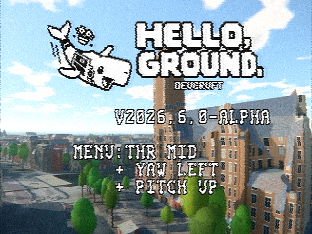 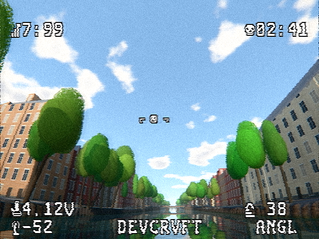 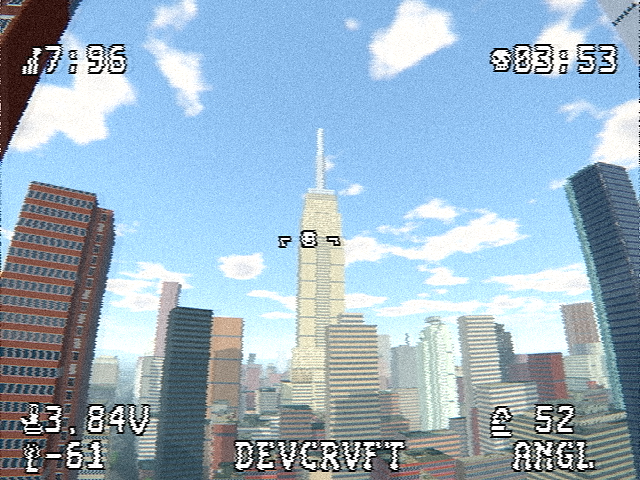

Font: [`themes/whalecrvft/whalecrvft.mcm`](themes/whalecrvft/whalecrvft.mcm) | layout: [`themes/whalecrvft/layout.txt`](themes/whalecrvft/layout.txt)

## VOID MOTH

Same HUD as WHALECRVFT, with the eye-spot moth and moon boot logo.

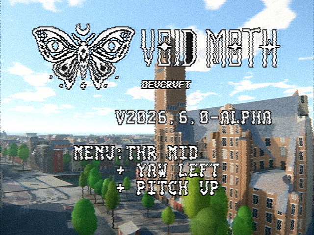 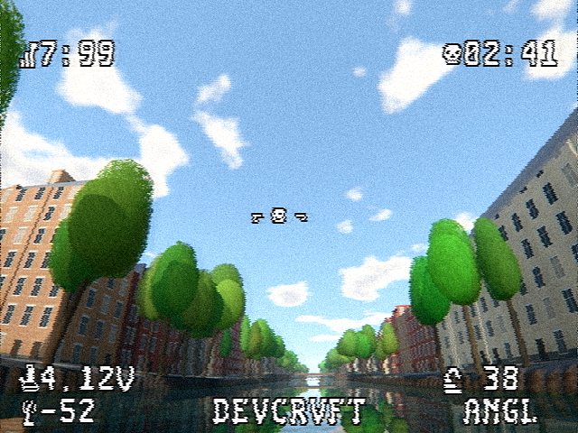 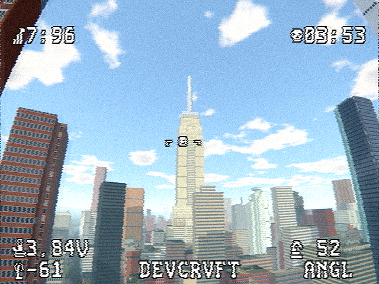

Font: [`themes/void-moth/void-moth.mcm`](themes/void-moth/void-moth.mcm) | layout: [`themes/void-moth/layout.txt`](themes/void-moth/layout.txt)

## SKY MUTANT

The Smiley Patch lives in your goggles: it grins on a full pack and melts when you push it too far.

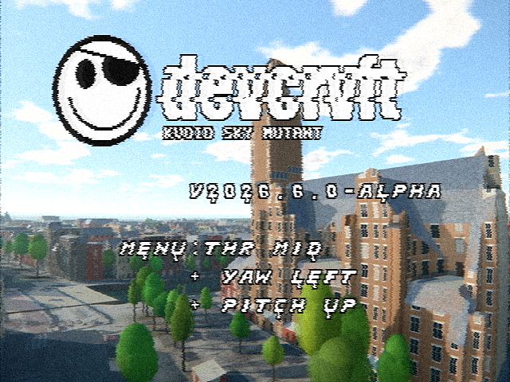  

Font: [`themes/sky-mutant/sky-mutant.mcm`](themes/sky-mutant/sky-mutant.mcm) | layout: [`themes/sky-mutant/layout.txt`](themes/sky-mutant/layout.txt)

## ROUND 1

Every pack is a fight and gravity is the opponent: life bar, round timer, K.O.

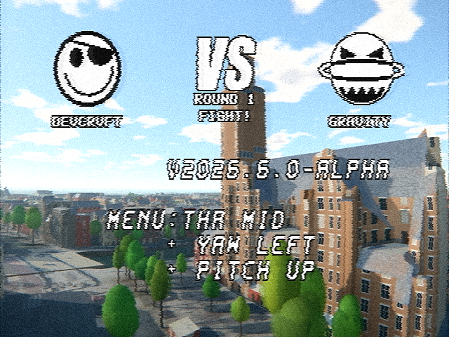 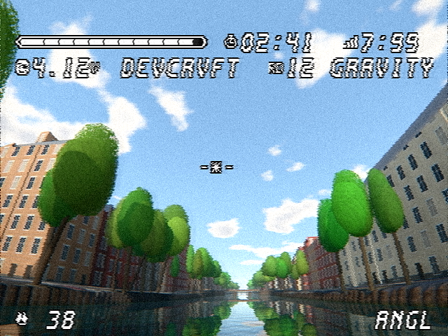 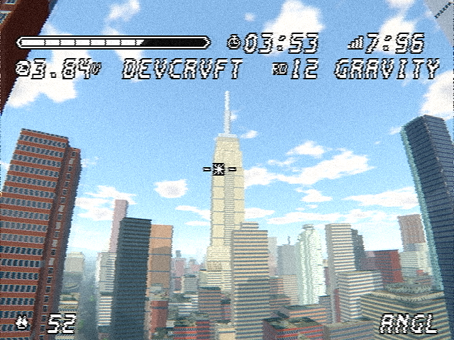

Font: [`themes/round-one/round-one.mcm`](themes/round-one/round-one.mcm) | layout: [`themes/round-one/layout.txt`](themes/round-one/layout.txt)

## RECOVERY MODE

The whoop boots into KVOID//OS and every readout is a terminal window over the video.

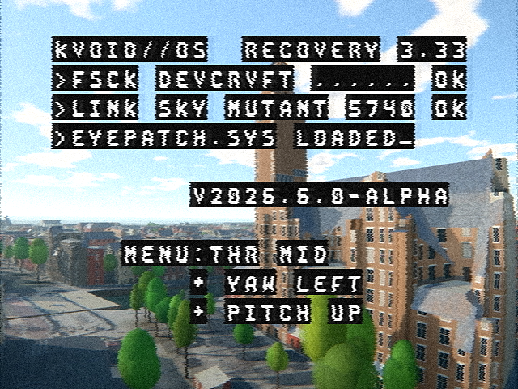 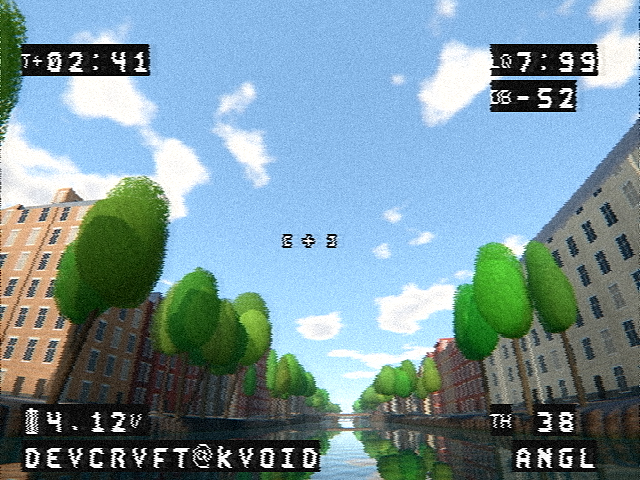 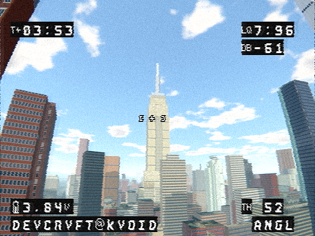

Font: [`themes/recovery-mode/recovery-mode.mcm`](themes/recovery-mode/recovery-mode.mcm) | layout: [`themes/recovery-mode/layout.txt`](themes/recovery-mode/layout.txt)

## Install

**Analog only** (a MAX7456-style OSD chip). DJI, Walksnail and HDZero use different font formats.

1. **Font:** Betaflight Configurator (or the Betaflight App) -> OSD tab -> **Font Manager** ->
   load the `.mcm` file -> **Upload font**. Then power-cycle the quad from a battery.
2. **Layout (optional):** the themes were laid out for NTSC (30 x 13). Paste the `set` lines
   from `layout.txt` into the CLI tab, then type `save`. They only move the elements the theme
   uses; anything else you have on screen stays where it is. Some layouts also set a pilot or
   craft name: edit those lines to your own before pasting.

Back up first: in the CLI, `diff all` and save the output somewhere.
